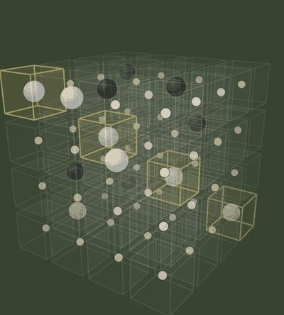
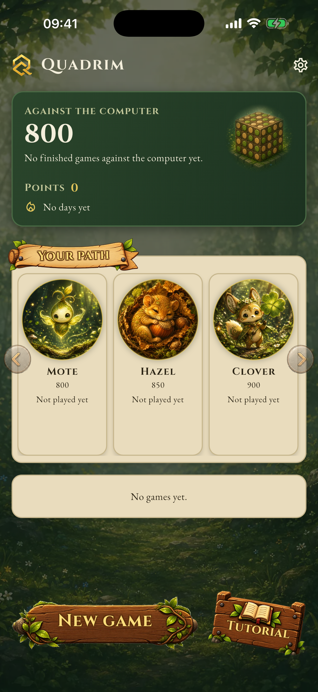
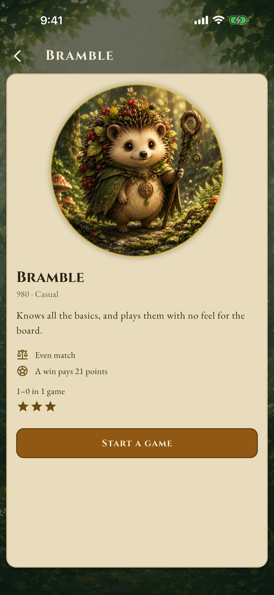
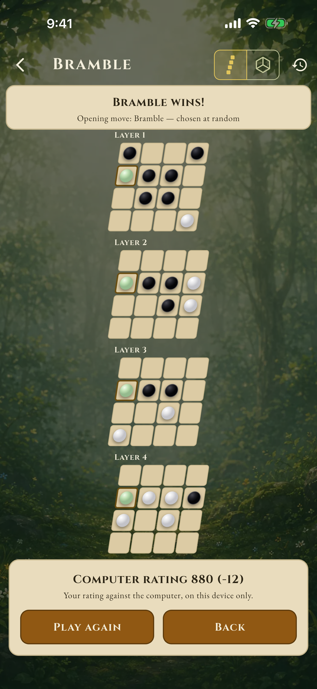
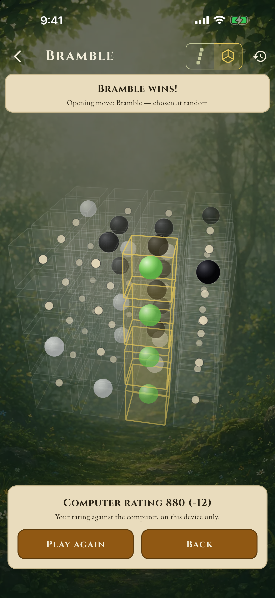
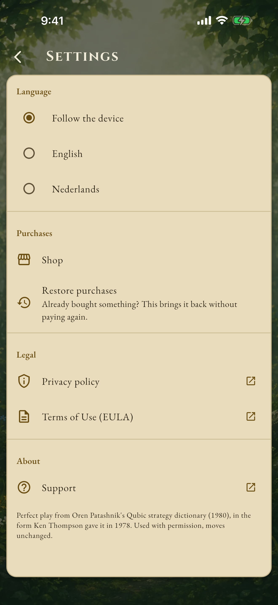
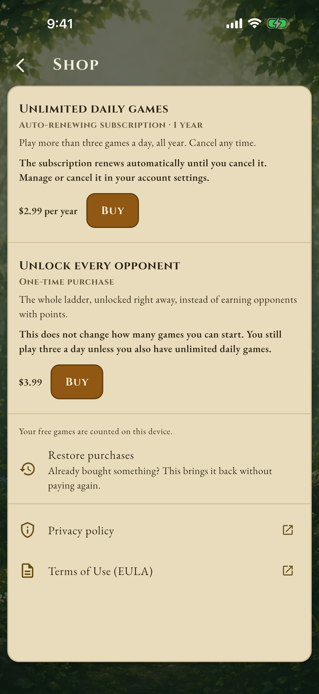
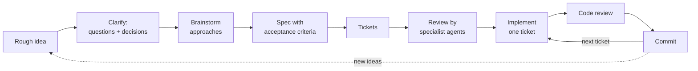

<h1 align="center">Quadrim</h1>

<b>Four in a row, but the board is a cube.</b>

Quadrim is four in a row played in a 4×4×4 cube, the game also known as Qubic. Sixteen squares become sixty-four cells, and lines run across each layer, straight up through the layers and along the diagonals of the cube — seventy-six ways to win, most of them hard to see until someone has used one on you. You climb a ladder of thirty-one computer opponents, from one that barely notices a threat to one that plays the solved game perfectly, or hand the phone across and play a friend.

> [!NOTE]
> **This whole game was vibe coded.** Apart from some later tweaks and additions, it was built in 4 weeks (8 working days) with an AI coding agent, following the workflow described in [CodingAgentOrchestration](https://github.com/evermeer/CodingAgentOrchestration). Every step and every prompt that was used is in [workflow.md](workflow.md), so you can follow along or build it again yourself.

  
  &nbsp;
  

  The Android version is waiting for testers before Google will publish it. 
  Request access to the Android test version with the form at the bottom of <a href="https://evict.nl/quadrim">evict.nl/quadrim</a>.

  
  
  

  
  
  

## About the game

**Thirty-one opponents.** A ladder that starts with a creature which barely notices a threat and ends with one that cannot be beaten. Each has a rating, a face and a temperament of its own. The opponent at the top cannot be beaten when it moves first — four in a row on a 4×4×4 board is a solved game, and it plays from the solution.

**Find your level.** Your own rating moves with every result, the way a chess rating does. A ten-game trend, a win-loss record against each opponent, and a path that opens up as you earn it.

**Quests and streaks.** Small goals that give a session a shape: a first win against someone new, a first win playing second, ten games in a day, a run of days in a row.

**Pass and play.** Hand the phone across. No account, no opponent search, no waiting for anyone.

**Learn it properly.** A tutorial that teaches the lines rather than the buttons, followed by a practice game against a gentle opponent.

**Plays anywhere.** The games, the opponents and the ratings all run on your device. No connection is needed to play, so a tunnel or a plane changes nothing.

**What is free.** The first month is unlimited. After that you can start three games a day and nine a week against the computer, for as long as you like. Pass and play, the tutorial, and finishing a game you have already started are never limited. Two optional purchases: *Unlimited play* lifts the daily and weekly limits, and *Unlock all opponents* opens the whole ladder straight away.

## How it was made

A person wrote the idea, answered the agent's questions and made the decisions; an AI coding agent wrote the code, one ticket at a time.

| | |
|---|---|
| Idea rewritten | 4 times, from [a rough idea](doc/history/idea-v0.md) to [the brief to rebuild from](doc/idea-v4.md) |
| Decisions logged | 396, each with the question it answered and what it cost |
| Tickets | 48 built, each one reviewed and committed on its own |
| Commits | 183 |
| Code | ~18,000 lines of Dart, plus ~16,000 lines of tests (800+ test cases) |
| Opponents | 31, each measured against its neighbours with a self-play calibration harness |

Every prompt used along the way is in [workflow.md](workflow.md), in the order it was given.

## Under the hood

- **Flutter** app for Android and iOS, with a **pure Dart engine** (`packages/quadrim_engine`) that holds the rules, the search and all thirty-one opponents. The engine has no Flutter, no I/O, no clock and no ambient randomness, so a position and a seed always give the same move.
- Opponents are data, not classes: one move chooser parameterised by a catalogue entry. Search budgets are counted in nodes, not milliseconds, so an opponent is equally strong on a fast phone and a slow one.
- The strongest opponents play from [Oren Patashnik's strategy dictionary](third_party/patashnik/NOTICE.md), the 1977 proof that the first player can always win.
- Every non-obvious choice is logged with its reasoning and cost — 390+ decisions across [the brief](doc/idea-v4.md), the [spec](doc/idea-v4-spec.md) and the [decision log](doc/idea-v4-decisions.md).

See [CLAUDE.md](CLAUDE.md) for how to build and test it (`bash tool/check.sh` is the gate).

## License

The code and the documentation are [MIT](LICENSE): learn from them, change them and reuse them in your own projects.

**Two exceptions, listed in [NOTICE.md](NOTICE.md):** the artwork (opponent avatars, background, logo, icons, signs and screenshots) and the name "Quadrim" are *not* covered by the MIT license — all rights reserved. If you publish a game built on this code, give it your own art and your own name.

Third-party parts keep their own terms: the fonts in `app/assets/fonts/` are under the SIL Open Font License, and the strategy dictionary has its terms in [`third_party/patashnik/`](third_party/patashnik/NOTICE.md).
